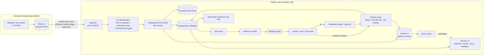

# Plan (Phase 1 output, approved 2026-09-21)

For research use only. Not for diagnostic use.

## Architecture

Tradeoffs and the reasons behind each choice are in `DECISIONS.md` (D-001 … D-018).

## Repo structure

See the tree in `README.md`. `src/secondreader/core` is modality-agnostic; `src/secondreader/modalities/<id>` are plugins.

## Datasets

Declared in `datasets/registry.yaml` with license and `commercial_ok`. Summary:

| Dataset | Role | Label quality | License → commercial? |
|---|---|---|---|
| NIH ChestX-ray14 | train | NLP-mined (noisy), ~984 boxes | No restrictions → **yes** |
| CheXpert | train | NLP + uncertain; val/test radiologist | Research only → no |
| MIMIC-CXR | train (optional, credentialed) | NLP; DICOM; longitudinal | PhysioNet CHDL → no |
| VinDr-CXR | **external test #1** | 3–5 radiologists, boxes, DICOM | PhysioNet CHDL → no |
| PadChest (manual subset) | **external test #2** | physician-labeled; has vendor | BIMCV DUA → no (verify) |
| BRAX | external test #3 (optional) | NLP | PhysioNet CHDL → no |
| CANDID-PTX | pneumothorax localization eval | radiologist masks | DUA → no (verify) |
| SIIM-ACR, ChestX-Det | localization only — **NIH-derived, never external** | radiologist | non-commercial |
| Kermany pediatric | OOD negatives | — | CC BY 4.0 → yes |

Two traps: (1) NIH images are re-released inside SIIM-ACR / RSNA / ChestX-Det — a perceptual-hash overlap check between train and external manifests is a CI test; (2) label noise is asymmetric (NLP train, radiologist test) — internal and external metrics are never averaged.

## Split strategy

* Unit = patient. Tier = `sha256(salt ‖ source ‖ patient_id) mod 100` → 80 / 10 / 10 per source.
* Internal validation: model selection, early stopping, temperature scaling, thresholds.
* Internal test: in-distribution sanity only.
* External test: VinDr-CXR (all; 3k consensus subset reported separately) + PadChest manual subset (+ BRAX). Locked by manifest hash before Phase 3 training; CI asserts no patient/image overlap and that the hash is unchanged.
* Targets: `pneumothorax`, `pleural_effusion`, `nodule_mass` (merged, D-012). CheXpert uncertain labels masked (D-017).
* Subgroups everywhere: source, vendor (PadChest), age band (18–39/40–59/60–79/80+), sex, AP vs PA. Bootstrap 95% CI; `low_n` flag when positives < 100.
