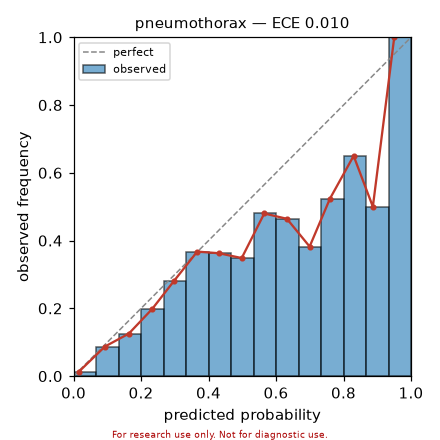
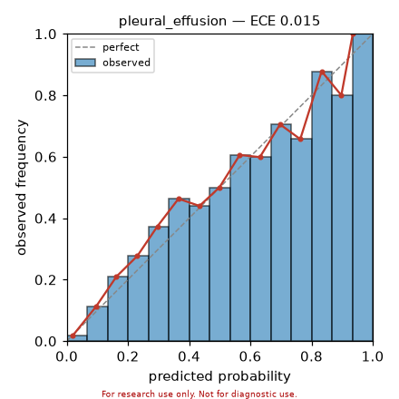
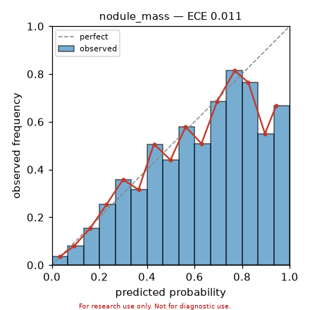

# Evaluation — cxr-nih-512-v1 on nih_cxr14 (test)

> **For research use only. Not for diagnostic use.**

- Model version: `643fa833d9b2dfe0`
- Dataset: `nih_cxr14` · tier: `test`
- Split manifest sha256: `96cda52f19d5b0a8a52198d5bb2045e0dabc124151ddc15be30e9607abb7ff50`
- Gated out (unable to assess): 183 — {'learned: out-of-distribution': 161, 'pixels: 36% of pixels saturated': 1, 'pixels: 56% of pixels saturated': 1, 'pixels: 41% of pixels saturated': 1, 'pixels: 35% of pixels saturated': 2, 'pixels: 47% of pixels saturated': 1, 'pixels: 48% of pixels saturated': 2, 'pixels: 43% of pixels saturated': 1, 'pixels: 37% of pixels saturated': 3, 'pixels: 40% of pixels saturated': 1, 'pixels: 39% of pixels saturated': 1, 'pixels: 42% of pixels saturated': 1, 'pixels: 61% of pixels saturated': 2, 'pixels: 46% of pixels saturated': 1, 'pixels: 49% of pixels saturated': 1, 'pixels: 71% of pixels saturated': 1, 'pixels: 59% of pixels saturated': 1, 'pixels: 66% of pixels saturated': 1}

## Overall

| group | finding | n | n_pos | AUROC [95% CI] | sens [95% CI] | spec [95% CI] | ECE | flag |
|---|---|---:|---:|---|---|---|---|---|
| all | pneumothorax | 11264 | 521 | 0.878 [0.862–0.893] | 0.806 [0.775–0.841] | 0.817 [0.810–0.825] | 0.010 |  |
| all | pleural_effusion | 11264 | 1420 | 0.889 [0.882–0.897] | 0.826 [0.809–0.845] | 0.809 [0.802–0.817] | 0.015 |  |
| all | nodule_mass | 11264 | 1133 | 0.808 [0.796–0.823] | 0.722 [0.699–0.748] | 0.753 [0.744–0.762] | 0.011 |  |

Operating thresholds: pneumothorax=0.047, pleural_effusion=0.120, nodule_mass=0.093

## Calibration (reliability diagrams)

## Per-subgroup performance

Subgroup metrics are mandatory (D-010). `low-n` = fewer than 100 positives; treat those estimates as unreliable. `unavailable` = metadata absent in this dataset.

### by source

| group | finding | n | n_pos | AUROC [95% CI] | sens [95% CI] | spec [95% CI] | ECE | flag |
|---|---|---:|---:|---|---|---|---|---|
| nih_cxr14 | pneumothorax | 11264 | 521 | 0.878 [0.862–0.893] | 0.806 [0.775–0.841] | 0.817 [0.810–0.825] | 0.010 |  |
| nih_cxr14 | pleural_effusion | 11264 | 1420 | 0.889 [0.882–0.897] | 0.826 [0.809–0.845] | 0.809 [0.802–0.817] | 0.015 |  |
| nih_cxr14 | nodule_mass | 11264 | 1133 | 0.808 [0.796–0.823] | 0.722 [0.699–0.748] | 0.753 [0.744–0.762] | 0.011 |  |

### by vendor

| group | finding | n | n_pos | AUROC [95% CI] | sens [95% CI] | spec [95% CI] | ECE | flag |
|---|---|---:|---:|---|---|---|---|---|
| unavailable | pneumothorax | 11264 | 521 | 0.878 [0.862–0.893] | 0.806 [0.775–0.841] | 0.817 [0.810–0.825] | 0.010 |  |
| unavailable | pleural_effusion | 11264 | 1420 | 0.889 [0.882–0.897] | 0.826 [0.809–0.845] | 0.809 [0.802–0.817] | 0.015 |  |
| unavailable | nodule_mass | 11264 | 1133 | 0.808 [0.796–0.823] | 0.722 [0.699–0.748] | 0.753 [0.744–0.762] | 0.011 |  |

### by age_band

| group | finding | n | n_pos | AUROC [95% CI] | sens [95% CI] | spec [95% CI] | ECE | flag |
|---|---|---:|---:|---|---|---|---|---|
| 18-39 | pneumothorax | 3163 | 169 | 0.880 [0.849–0.909] | 0.840 [0.789–0.888] | 0.806 [0.794–0.820] | 0.016 |  |
| 18-39 | pleural_effusion | 3163 | 280 | 0.891 [0.873–0.906] | 0.764 [0.704–0.813] | 0.848 [0.837–0.862] | 0.020 |  |
| 18-39 | nodule_mass | 3163 | 246 | 0.805 [0.776–0.828] | 0.671 [0.617–0.722] | 0.792 [0.779–0.805] | 0.013 |  |
| 40-59 | pneumothorax | 5102 | 219 | 0.869 [0.845–0.893] | 0.781 [0.731–0.833] | 0.820 [0.809–0.832] | 0.009 |  |
| 40-59 | pleural_effusion | 5102 | 682 | 0.891 [0.882–0.903] | 0.836 [0.808–0.859] | 0.802 [0.791–0.814] | 0.017 |  |
| 40-59 | nodule_mass | 5102 | 543 | 0.813 [0.794–0.832] | 0.724 [0.682–0.758] | 0.768 [0.757–0.780] | 0.017 |  |
| 60-79 | pneumothorax | 2453 | 120 | 0.890 [0.856–0.913] | 0.825 [0.750–0.887] | 0.807 [0.792–0.824] | 0.009 |  |
| 60-79 | pleural_effusion | 2453 | 406 | 0.872 [0.854–0.887] | 0.860 [0.823–0.890] | 0.749 [0.728–0.766] | 0.024 |  |
| 60-79 | nodule_mass | 2453 | 286 | 0.785 [0.756–0.812] | 0.759 [0.708–0.813] | 0.658 [0.639–0.677] | 0.014 |  |
| 80+ | pneumothorax | 66 | 1 | 0.292 [0.188–0.453] | 0.000 [0.000–0.000] | 0.769 [0.677–0.855] | 0.039 | low-n |
| 80+ | pleural_effusion | 66 | 6 | 0.883 [0.733–0.997] | 0.667 [0.250–1.000] | 0.850 [0.754–0.934] | 0.052 | low-n |
| 80+ | nodule_mass | 66 | 13 | 0.727 [0.581–0.852] | 0.846 [0.666–1.000] | 0.453 [0.308–0.604] | 0.143 | low-n |
| <18 | pneumothorax | 480 | 12 | 0.915 [0.869–0.957] | 0.667 [0.400–0.923] | 0.900 [0.874–0.925] | 0.005 | low-n |
| <18 | pleural_effusion | 480 | 46 | 0.902 [0.848–0.948] | 0.783 [0.651–0.904] | 0.889 [0.861–0.914] | 0.036 | low-n |
| <18 | nodule_mass | 480 | 45 | 0.842 [0.773–0.908] | 0.711 [0.571–0.857] | 0.837 [0.799–0.871] | 0.027 | low-n |

### by sex

| group | finding | n | n_pos | AUROC [95% CI] | sens [95% CI] | spec [95% CI] | ECE | flag |
|---|---|---:|---:|---|---|---|---|---|
| F | pneumothorax | 4797 | 229 | 0.856 [0.821–0.883] | 0.803 [0.746–0.858] | 0.767 [0.757–0.782] | 0.016 |  |
| F | pleural_effusion | 4797 | 670 | 0.894 [0.883–0.906] | 0.839 [0.812–0.868] | 0.807 [0.794–0.817] | 0.022 |  |
| F | nodule_mass | 4797 | 459 | 0.807 [0.785–0.829] | 0.719 [0.681–0.758] | 0.739 [0.726–0.751] | 0.014 |  |
| M | pneumothorax | 6467 | 292 | 0.893 [0.869–0.914] | 0.808 [0.768–0.857] | 0.853 [0.845–0.863] | 0.010 |  |
| M | pleural_effusion | 6467 | 750 | 0.884 [0.872–0.895] | 0.815 [0.779–0.841] | 0.810 [0.800–0.820] | 0.013 |  |
| M | nodule_mass | 6467 | 674 | 0.808 [0.791–0.825] | 0.724 [0.692–0.759] | 0.764 [0.751–0.775] | 0.012 |  |

### by view

| group | finding | n | n_pos | AUROC [95% CI] | sens [95% CI] | spec [95% CI] | ECE | flag |
|---|---|---:|---:|---|---|---|---|---|
| AP | pneumothorax | 4418 | 198 | 0.849 [0.818–0.876] | 0.742 [0.682–0.799] | 0.849 [0.839–0.859] | 0.008 |  |
| AP | pleural_effusion | 4418 | 729 | 0.852 [0.840–0.865] | 0.841 [0.814–0.865] | 0.712 [0.696–0.724] | 0.026 |  |
| AP | nodule_mass | 4418 | 381 | 0.755 [0.726–0.783] | 0.606 [0.548–0.665] | 0.760 [0.748–0.773] | 0.020 |  |
| PA | pneumothorax | 6846 | 323 | 0.896 [0.875–0.914] | 0.845 [0.801–0.884] | 0.796 [0.787–0.806] | 0.013 |  |
| PA | pleural_effusion | 6846 | 691 | 0.906 [0.892–0.917] | 0.810 [0.773–0.838] | 0.867 [0.860–0.875] | 0.012 |  |
| PA | nodule_mass | 6846 | 752 | 0.837 [0.822–0.853] | 0.781 [0.754–0.808] | 0.748 [0.738–0.759] | 0.018 |  |

## Notes

- Operating point: youden (chosen on internal validation).
- Temperatures: {'pneumothorax': 1.787, 'pleural_effusion': 1.305, 'nodule_mass': 1.5}
- Bootstrap 95% CIs (n=200). Internal and external metrics are never averaged.

---
For research use only. Not for diagnostic use.