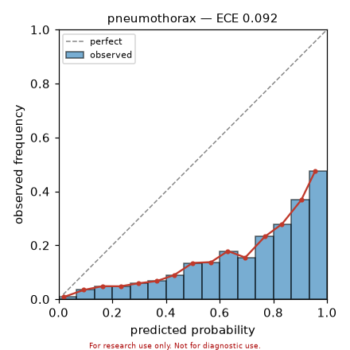
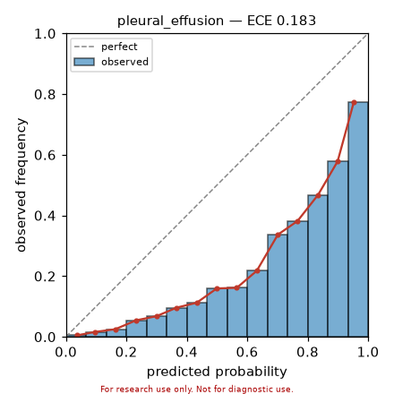
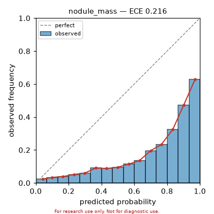

# Evaluation — cxr-nih-baseline-v1 on nih_cxr14 (test)

> **For research use only. Not for diagnostic use.**

- Model version: `cacea466e3727bf6`
- Dataset: `nih_cxr14` · tier: `test`
- Split manifest sha256: `96cda52f19d5b0a8a52198d5bb2045e0dabc124151ddc15be30e9607abb7ff50`
- Gated out (unable to assess): 148 — {'learned: out-of-distribution': 127, 'pixels: 36% of pixels saturated': 1, 'pixels: 56% of pixels saturated': 1, 'pixels: 41% of pixels saturated': 1, 'pixels: 35% of pixels saturated': 2, 'pixels: 47% of pixels saturated': 1, 'pixels: 48% of pixels saturated': 2, 'pixels: 43% of pixels saturated': 1, 'pixels: 37% of pixels saturated': 3, 'pixels: 40% of pixels saturated': 1, 'pixels: 39% of pixels saturated': 1, 'pixels: 42% of pixels saturated': 1, 'pixels: 61% of pixels saturated': 2, 'pixels: 46% of pixels saturated': 1, 'pixels: 49% of pixels saturated': 1, 'pixels: 71% of pixels saturated': 1, 'pixels: 59% of pixels saturated': 1, 'pixels: 66% of pixels saturated': 1}

## Overall

| group | finding | n | n_pos | AUROC [95% CI] | sens [95% CI] | spec [95% CI] | ECE | flag |
|---|---|---:|---:|---|---|---|---|---|
| all | pneumothorax | 11299 | 535 | 0.883 [0.869–0.899] | 0.817 [0.785–0.848] | 0.781 [0.773–0.788] | 0.092 |  |
| all | pleural_effusion | 11299 | 1420 | 0.886 [0.878–0.894] | 0.860 [0.842–0.878] | 0.763 [0.756–0.773] | 0.183 |  |
| all | nodule_mass | 11299 | 1135 | 0.796 [0.784–0.812] | 0.697 [0.671–0.722] | 0.751 [0.743–0.759] | 0.216 |  |

Operating thresholds: pneumothorax=0.126, pleural_effusion=0.427, nodule_mass=0.409

## Calibration (reliability diagrams)

## Per-subgroup performance

Subgroup metrics are mandatory (D-010). `low-n` = fewer than 100 positives; treat those estimates as unreliable. `unavailable` = metadata absent in this dataset.

### by source

| group | finding | n | n_pos | AUROC [95% CI] | sens [95% CI] | spec [95% CI] | ECE | flag |
|---|---|---:|---:|---|---|---|---|---|
| nih_cxr14 | pneumothorax | 11299 | 535 | 0.883 [0.869–0.899] | 0.817 [0.785–0.848] | 0.781 [0.773–0.788] | 0.092 |  |
| nih_cxr14 | pleural_effusion | 11299 | 1420 | 0.886 [0.878–0.894] | 0.860 [0.842–0.878] | 0.763 [0.756–0.773] | 0.183 |  |
| nih_cxr14 | nodule_mass | 11299 | 1135 | 0.796 [0.784–0.812] | 0.697 [0.671–0.722] | 0.751 [0.743–0.759] | 0.216 |  |

### by vendor

| group | finding | n | n_pos | AUROC [95% CI] | sens [95% CI] | spec [95% CI] | ECE | flag |
|---|---|---:|---:|---|---|---|---|---|
| unavailable | pneumothorax | 11299 | 535 | 0.883 [0.869–0.899] | 0.817 [0.785–0.848] | 0.781 [0.773–0.788] | 0.092 |  |
| unavailable | pleural_effusion | 11299 | 1420 | 0.886 [0.878–0.894] | 0.860 [0.842–0.878] | 0.763 [0.756–0.773] | 0.183 |  |
| unavailable | nodule_mass | 11299 | 1135 | 0.796 [0.784–0.812] | 0.697 [0.671–0.722] | 0.751 [0.743–0.759] | 0.216 |  |

### by age_band

| group | finding | n | n_pos | AUROC [95% CI] | sens [95% CI] | spec [95% CI] | ECE | flag |
|---|---|---:|---:|---|---|---|---|---|
| 18-39 | pneumothorax | 3185 | 177 | 0.886 [0.862–0.915] | 0.836 [0.782–0.889] | 0.769 [0.754–0.784] | 0.102 |  |
| 18-39 | pleural_effusion | 3185 | 277 | 0.889 [0.870–0.908] | 0.801 [0.753–0.844] | 0.796 [0.782–0.810] | 0.171 |  |
| 18-39 | nodule_mass | 3185 | 252 | 0.795 [0.765–0.825] | 0.667 [0.601–0.724] | 0.776 [0.761–0.789] | 0.202 |  |
| 40-59 | pneumothorax | 5119 | 223 | 0.882 [0.859–0.902] | 0.812 [0.763–0.863] | 0.786 [0.775–0.796] | 0.089 |  |
| 40-59 | pleural_effusion | 5119 | 688 | 0.885 [0.873–0.896] | 0.869 [0.838–0.893] | 0.764 [0.754–0.777] | 0.178 |  |
| 40-59 | nodule_mass | 5119 | 544 | 0.801 [0.780–0.821] | 0.713 [0.681–0.752] | 0.765 [0.753–0.777] | 0.211 |  |
| 60-79 | pneumothorax | 2454 | 121 | 0.884 [0.857–0.912] | 0.835 [0.771–0.902] | 0.763 [0.746–0.779] | 0.096 |  |
| 60-79 | pleural_effusion | 2454 | 406 | 0.870 [0.853–0.885] | 0.897 [0.866–0.924] | 0.684 [0.664–0.705] | 0.223 |  |
| 60-79 | nodule_mass | 2454 | 283 | 0.762 [0.725–0.790] | 0.689 [0.637–0.735] | 0.677 [0.660–0.696] | 0.252 |  |
| 80+ | pneumothorax | 66 | 1 | 0.262 [0.156–0.391] | 0.000 [0.000–0.000] | 0.708 [0.600–0.804] | 0.128 | low-n |
| 80+ | pleural_effusion | 66 | 6 | 0.922 [0.766–1.000] | 0.833 [0.498–1.000] | 0.800 [0.707–0.895] | 0.279 | low-n |
| 80+ | nodule_mass | 66 | 13 | 0.726 [0.599–0.858] | 0.769 [0.571–1.000] | 0.472 [0.340–0.611] | 0.327 | low-n |
| <18 | pneumothorax | 475 | 13 | 0.913 [0.859–0.960] | 0.538 [0.267–0.800] | 0.905 [0.882–0.927] | 0.033 | low-n |
| <18 | pleural_effusion | 475 | 43 | 0.904 [0.846–0.944] | 0.744 [0.617–0.858] | 0.907 [0.875–0.934] | 0.111 | low-n |
| <18 | nodule_mass | 475 | 43 | 0.853 [0.779–0.908] | 0.698 [0.540–0.833] | 0.836 [0.799–0.865] | 0.151 | low-n |

### by sex

| group | finding | n | n_pos | AUROC [95% CI] | sens [95% CI] | spec [95% CI] | ECE | flag |
|---|---|---:|---:|---|---|---|---|---|
| F | pneumothorax | 4799 | 234 | 0.856 [0.829–0.877] | 0.803 [0.750–0.848] | 0.723 [0.711–0.736] | 0.113 |  |
| F | pleural_effusion | 4799 | 670 | 0.890 [0.877–0.904] | 0.872 [0.845–0.899] | 0.766 [0.752–0.779] | 0.175 |  |
| F | nodule_mass | 4799 | 467 | 0.802 [0.779–0.825] | 0.698 [0.655–0.738] | 0.766 [0.753–0.780] | 0.204 |  |
| M | pneumothorax | 6500 | 301 | 0.903 [0.886–0.917] | 0.827 [0.789–0.866] | 0.823 [0.814–0.832] | 0.076 |  |
| M | pleural_effusion | 6500 | 750 | 0.882 [0.870–0.893] | 0.849 [0.822–0.875] | 0.762 [0.750–0.771] | 0.189 |  |
| M | nodule_mass | 6500 | 668 | 0.790 [0.770–0.810] | 0.696 [0.657–0.733] | 0.740 [0.729–0.749] | 0.225 |  |

### by view

| group | finding | n | n_pos | AUROC [95% CI] | sens [95% CI] | spec [95% CI] | ECE | flag |
|---|---|---:|---:|---|---|---|---|---|
| AP | pneumothorax | 4446 | 208 | 0.863 [0.841–0.886] | 0.764 [0.707–0.823] | 0.779 [0.765–0.792] | 0.089 |  |
| AP | pleural_effusion | 4446 | 731 | 0.848 [0.836–0.860] | 0.869 [0.843–0.891] | 0.673 [0.660–0.687] | 0.214 |  |
| AP | nodule_mass | 4446 | 384 | 0.739 [0.711–0.764] | 0.562 [0.517–0.615] | 0.760 [0.750–0.775] | 0.203 |  |
| PA | pneumothorax | 6853 | 327 | 0.895 [0.876–0.914] | 0.850 [0.812–0.883] | 0.782 [0.772–0.792] | 0.094 |  |
| PA | pleural_effusion | 6853 | 689 | 0.905 [0.894–0.916] | 0.851 [0.824–0.876] | 0.818 [0.808–0.828] | 0.163 |  |
| PA | nodule_mass | 6853 | 751 | 0.826 [0.807–0.842] | 0.766 [0.733–0.793] | 0.744 [0.733–0.755] | 0.224 |  |

## Notes

- Operating point: youden (chosen on internal validation).
- Temperatures: {'pneumothorax': 1.175, 'pleural_effusion': 1.243, 'nodule_mass': 0.965}
- Bootstrap 95% CIs (n=200). Internal and external metrics are never averaged.

---
For research use only. Not for diagnostic use.