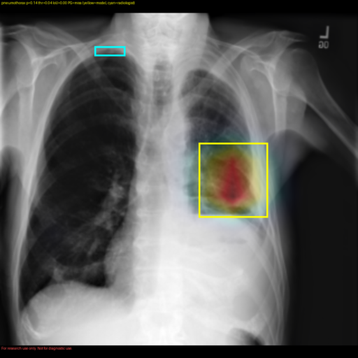
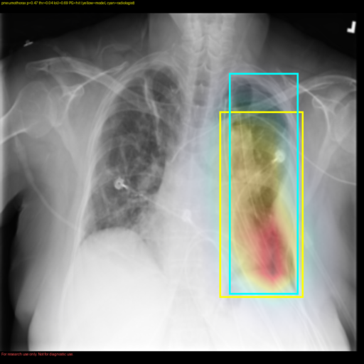
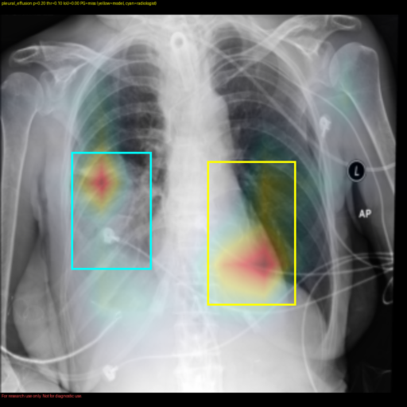
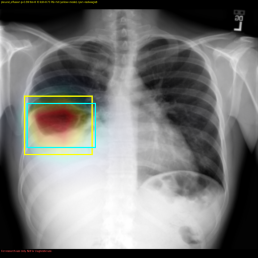
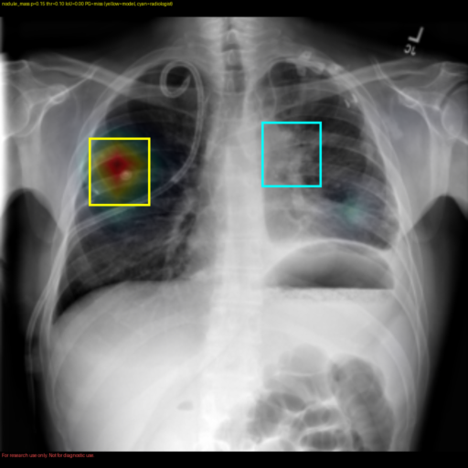
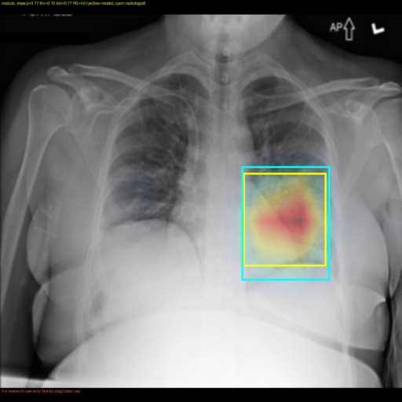

# Localisation evaluation — cxr-nih-baseline-v1 vs NIH radiologist boxes

> **For research use only. Not for diagnostic use.**

- Model version: `cc2f56aa3325788c`
- Boxes: `data/raw/nih_cxr14/BBox_List_2017.csv` (NIH ChestX-ray14 `BBox_List_2017.csv`; NIH-derived, evaluation only, never a training signal)
- Rows evaluated (image × finding): 415 on 399 images — pneumothorax=98, pleural_effusion=153, nodule_mass=164
- Ignored NIH labels (not our findings): none
- Split tier of the boxed images (second-reader/datasets/splits/nih-v1): test=43, train=338, val=34
- Gate: 9 rows would have been `unable_to_assess` (scored anyway; the box is what a bench user would see)
- Called present at threshold: 388 / 415 rows
- Mean GT box area fraction: pneumothorax=5.2%, pleural_effusion=6.9%, nodule_mass=2.4%

## How to read this

- **pointing game** — heat-map argmax lies inside the radiologist's box.
- **IoU / hit@IoU** — our derived box (largest component ≥ 0.5·max of the Grad-CAM) vs the radiologist's box.
- **heat mass in GT box** — fraction of heat-map mass inside the radiologist's box.
- **random** — a box of our size at a uniform random position, a random pointing location, a uniform heat-map (32 draws/row). **centre** — Gaussian centre prior (σ = 0.2·short side), boxed by the same rule.
- 95% CIs are percentile bootstrap over rows. Most NIH box images are in this model's **training** tier; only the `val`/`test` rows are held-out evidence and they are low-n.

## Overall

| group | finding | source | n | pointing game | mean IoU | hit@IoU≥0.3 | hit@IoU≥0.5 | heat mass in GT box |
|---|---|---|---:|---|---|---|---|---|
| all rows | all | model | 415 | 47% [42–52] | 0.201 [0.182–0.220] | 30% [26–35] | 9% [6–12] | 19% [17–21] |
| all rows | all | random | 415 | 5% [4–5] | 0.037 [0.034–0.041] | 3% [3–4] | 1% [0–1] | 5% [4–5] |
| all rows | all | centre | 415 | 3% [2–5] | 0.060 [0.052–0.070] | 3% [1–5] | 0% [0–1] | 7% [6–8] |
| all rows | pneumothorax | model | 98 | 32% [23–42] | 0.174 [0.135–0.214] | 27% [18–36] | 10% [5–16] | 19% [15–23] |
| all rows | pneumothorax | random | 98 | 6% [4–7] | 0.043 [0.037–0.050] | 4% [3–5] | 1% [0–1] | 5% [4–6] |
| all rows | pneumothorax | centre | 98 | 1% [0–3] | 0.051 [0.037–0.065] | 1% [0–3] | 0% [0–0] | 7% [5–8] |
| all rows | pleural_effusion | model | 153 | 56% [48–63] | 0.245 [0.215–0.275] | 42% [35–50] | 8% [5–13] | 25% [22–28] |
| all rows | pleural_effusion | random | 153 | 6% [5–8] | 0.049 [0.044–0.055] | 5% [4–6] | 1% [0–1] | 7% [6–8] |
| all rows | pleural_effusion | centre | 153 | 3% [1–5] | 0.070 [0.057–0.083] | 2% [0–5] | 0% [0–0] | 9% [8–10] |
| all rows | nodule_mass | model | 164 | 48% [40–56] | 0.175 [0.148–0.205] | 21% [15–27] | 8% [4–12] | 13% [11–16] |
| all rows | nodule_mass | random | 164 | 2% [2–3] | 0.022 [0.018–0.028] | 2% [1–2] | 0% [0–1] | 2% [2–3] |
| all rows | nodule_mass | centre | 164 | 5% [2–9] | 0.057 [0.042–0.075] | 5% [2–9] | 1% [0–3] | 5% [4–7] |

## By model call at threshold

| group | finding | source | n | pointing game | mean IoU | hit@IoU≥0.3 | hit@IoU≥0.5 | heat mass in GT box |
|---|---|---|---:|---|---|---|---|---|
| called present | all | model | 388 | 49% [45–54] | 0.209 [0.191–0.228] | 32% [28–37] | 9% [7–12] | 20% [18–22] |
| called present | all | random | 388 | 5% [4–6] | 0.038 [0.035–0.042] | 3% [3–4] | 1% [0–1] | 5% [4–5] |
| called present | all | centre | 388 | 3% [2–5] | 0.062 [0.053–0.071] | 3% [2–5] | 1% [0–1] | 7% [6–8] |
| called present | pneumothorax | model | 96 | 31% [22–41] | 0.174 [0.139–0.214] | 27% [20–36] | 10% [5–17] | 19% [15–23] |
| called present | pneumothorax | random | 96 | 6% [4–7] | 0.043 [0.037–0.051] | 4% [3–5] | 1% [0–1] | 5% [4–6] |
| called present | pneumothorax | centre | 96 | 1% [0–3] | 0.052 [0.037–0.067] | 1% [0–3] | 0% [0–0] | 7% [5–8] |
| called present | pleural_effusion | model | 147 | 58% [50–65] | 0.253 [0.223–0.281] | 44% [37–52] | 9% [5–14] | 26% [23–29] |
| called present | pleural_effusion | random | 147 | 7% [5–8] | 0.049 [0.044–0.055] | 5% [4–6] | 1% [0–1] | 7% [6–8] |
| called present | pleural_effusion | centre | 147 | 3% [1–5] | 0.070 [0.058–0.084] | 2% [0–5] | 0% [0–0] | 9% [8–11] |
| called present | nodule_mass | model | 145 | 53% [45–61] | 0.188 [0.154–0.216] | 23% [17–30] | 9% [4–14] | 14% [12–18] |
| called present | nodule_mass | random | 145 | 3% [2–4] | 0.024 [0.019–0.029] | 2% [1–3] | 0% [0–1] | 3% [2–4] |
| called present | nodule_mass | centre | 145 | 6% [2–10] | 0.060 [0.042–0.081] | 6% [2–10] | 1% [0–3] | 5% [4–7] |
| called absent | all | model | 27 | 11% [0–26] | 0.076 [0.040–0.120] | 4% [0–11] | 0% [0–0] | 7% [4–10] |
| called absent | all | random | 27 | 2% [0–4] | 0.017 [0.010–0.027] | 0% [0–1] | 0% [0–0] | 2% [1–4] |
| called absent | all | centre | 27 | 4% [0–11] | 0.040 [0.015–0.074] | 4% [0–11] | 0% [0–0] | 4% [2–7] |
| called absent | pneumothorax | model | 2 | 50% [0–100] | 0.178 [0.177–0.180] | 0% [0–0] | 0% [0–0] | 11% [4–17] |
| called absent | pneumothorax | random | 2 | 2% [0–3] | 0.011 [0.004–0.018] | 0% [0–0] | 0% [0–0] | 4% [1–7] |
| called absent | pneumothorax | centre | 2 | 0% [0–0] | 0.000 [0.000–0.000] | 0% [0–0] | 0% [0–0] | 1% [0–2] |
| called absent | pleural_effusion | model | 6 | 0% [0–0] | 0.039 [0.000–0.118] | 0% [0–0] | 0% [0–0] | 9% [2–19] |
| called absent | pleural_effusion | random | 6 | 6% [0–14] | 0.046 [0.027–0.071] | 2% [0–4] | 1% [0–2] | 6% [3–11] |
| called absent | pleural_effusion | centre | 6 | 0% [0–0] | 0.050 [0.014–0.089] | 0% [0–0] | 0% [0–0] | 7% [3–12] |
| called absent | nodule_mass | model | 19 | 11% [0–26] | 0.076 [0.034–0.132] | 5% [0–16] | 0% [0–0] | 5% [2–10] |
| called absent | nodule_mass | random | 19 | 1% [0–1] | 0.009 [0.005–0.014] | 0% [0–0] | 0% [0–0] | 1% [0–2] |
| called absent | nodule_mass | centre | 19 | 5% [0–16] | 0.040 [0.012–0.084] | 5% [0–16] | 0% [0–0] | 3% [1–6] |

## By split tier (train = seen in training; val/test = held-out patients)

| group | finding | source | n | pointing game | mean IoU | hit@IoU≥0.3 | hit@IoU≥0.5 | heat mass in GT box |
|---|---|---|---:|---|---|---|---|---|
| train | all | model | 338 | 46% [41–51] | 0.197 [0.177–0.216] | 30% [25–35] | 8% [5–11] | 19% [17–21] |
| train | all | random | 338 | 5% [4–5] | 0.035 [0.032–0.039] | 3% [2–4] | 1% [0–1] | 5% [4–5] |
| train | all | centre | 338 | 3% [1–5] | 0.059 [0.049–0.070] | 3% [1–5] | 0% [0–1] | 7% [6–8] |
| train | pneumothorax | model | 79 | 28% [18–39] | 0.161 [0.121–0.206] | 24% [15–34] | 9% [4–15] | 18% [13–23] |
| train | pneumothorax | random | 79 | 6% [4–7] | 0.043 [0.035–0.051] | 4% [3–5] | 1% [0–1] | 5% [4–6] |
| train | pneumothorax | centre | 79 | 1% [0–4] | 0.049 [0.034–0.067] | 1% [0–4] | 0% [0–0] | 6% [5–8] |
| train | pleural_effusion | model | 125 | 55% [47–64] | 0.245 [0.213–0.281] | 42% [33–51] | 9% [4–14] | 25% [22–28] |
| train | pleural_effusion | random | 125 | 6% [5–8] | 0.046 [0.040–0.052] | 4% [3–5] | 1% [0–1] | 7% [6–8] |
| train | pleural_effusion | centre | 125 | 2% [0–6] | 0.068 [0.054–0.084] | 2% [0–4] | 0% [0–0] | 9% [7–10] |
| train | nodule_mass | model | 134 | 49% [40–57] | 0.174 [0.146–0.204] | 22% [14–28] | 7% [3–11] | 13% [10–16] |
| train | nodule_mass | random | 134 | 2% [2–3] | 0.021 [0.017–0.027] | 1% [1–2] | 0% [0–1] | 2% [2–3] |
| train | nodule_mass | centre | 134 | 5% [1–9] | 0.056 [0.038–0.077] | 5% [1–10] | 1% [0–2] | 5% [3–6] |
| val | all | model | 34 | 53% [38–71] | 0.258 [0.187–0.334] | 41% [26–59] | 18% [6–32] | 26% [19–33] |
| val | all | random | 34 | 6% [3–8] | 0.052 [0.041–0.066] | 5% [3–8] | 1% [0–2] | 6% [4–8] |
| val | all | centre | 34 | 3% [0–9] | 0.073 [0.048–0.101] | 3% [0–9] | 0% [0–0] | 9% [6–12] |
| val | pneumothorax | model | 10 | 30% [10–60] | 0.212 [0.100–0.337] | 30% [0–60] | 20% [0–50] | 25% [12–38] |
| val | pneumothorax | random | 10 | 5% [2–8] | 0.048 [0.032–0.064] | 4% [2–7] | 1% [0–2] | 6% [3–10] |
| val | pneumothorax | centre | 10 | 0% [0–0] | 0.067 [0.031–0.108] | 0% [0–0] | 0% [0–0] | 9% [4–15] |
| val | pleural_effusion | model | 15 | 67% [40–87] | 0.284 [0.201–0.367] | 53% [27–80] | 7% [0–20] | 30% [22–39] |
| val | pleural_effusion | random | 15 | 8% [4–13] | 0.062 [0.045–0.080] | 6% [3–10] | 1% [0–2] | 8% [5–12] |
| val | pleural_effusion | centre | 15 | 7% [0–20] | 0.092 [0.048–0.144] | 7% [0–20] | 0% [0–0] | 12% [7–17] |
| val | nodule_mass | model | 9 | 56% [22–89] | 0.268 [0.104–0.480] | 33% [11–67] | 33% [0–67] | 20% [7–36] |
| val | nodule_mass | random | 9 | 3% [1–5] | 0.041 [0.016–0.068] | 5% [0–10] | 2% [0–3] | 2% [1–4] |
| val | nodule_mass | centre | 9 | 0% [0–0] | 0.049 [0.014–0.087] | 0% [0–0] | 0% [0–0] | 4% [1–8] |
| test | all | model | 43 | 49% [35–63] | 0.182 [0.132–0.235] | 26% [14–40] | 7% [0–14] | 17% [12–22] |
| test | all | random | 43 | 4% [2–6] | 0.038 [0.027–0.050] | 4% [2–6] | 0% [0–1] | 5% [3–7] |
| test | all | centre | 43 | 5% [0–12] | 0.063 [0.032–0.103] | 5% [0–12] | 2% [0–7] | 7% [4–12] |
| test | pneumothorax | model | 9 | 67% [33–100] | 0.251 [0.146–0.370] | 44% [11–78] | 11% [0–33] | 23% [13–34] |
| test | pneumothorax | random | 9 | 6% [2–11] | 0.037 [0.020–0.053] | 3% [1–6] | 0% [0–0] | 5% [3–8] |
| test | pneumothorax | centre | 9 | 0% [0–0] | 0.052 [0.019–0.090] | 0% [0–0] | 0% [0–0] | 6% [3–10] |
| test | pleural_effusion | model | 13 | 46% [23–69] | 0.198 [0.098–0.310] | 31% [8–62] | 8% [0–23] | 19% [9–30] |
| test | pleural_effusion | random | 13 | 6% [2–10] | 0.066 [0.043–0.093] | 8% [4–14] | 1% [0–2] | 6% [3–10] |
| test | pleural_effusion | centre | 13 | 0% [0–0] | 0.060 [0.031–0.103] | 0% [0–0] | 0% [0–0] | 8% [4–14] |
| test | nodule_mass | model | 21 | 43% [24–62] | 0.143 [0.082–0.203] | 14% [0–29] | 5% [0–14] | 13% [6–21] |
| test | nodule_mass | random | 21 | 2% [0–5] | 0.021 [0.012–0.031] | 1% [0–2] | 0% [0–1] | 3% [1–7] |
| test | nodule_mass | centre | 21 | 10% [0–24] | 0.069 [0.014–0.141] | 10% [0–24] | 5% [0–14] | 7% [2–16] |

## Examples (yellow = model box, cyan = radiologist box)

**bad** — pneumothorax on `00020000_000.png` (IoU 0.00)

**good** — pneumothorax on `00014822_039.png` (IoU 0.69)

**bad** — pleural_effusion on `00018253_059.png` (IoU 0.00)

**good** — pleural_effusion on `00014015_003.png` (IoU 0.70)

**bad** — nodule_mass on `00011269_019.png` (IoU 0.00)

**good** — nodule_mass on `00030323_015.png` (IoU 0.77)

## Caveats

- NIH boxes are one radiologist's box per finding on ≈ 880 images; there is no inter-reader agreement to bound the ceiling.
- Grad-CAM resolution is the last DenseNet block (10×10 at 320 px) upsampled, so boxes are coarse by construction; a small nodule cannot be tightly boxed.
- The derived box is the *largest* high-heat component; a correct secondary peak on a multi-focal finding is not credited.

_For research use only. Not for diagnostic use._
