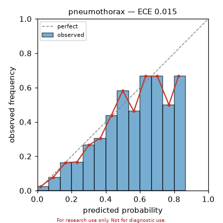
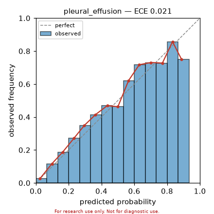
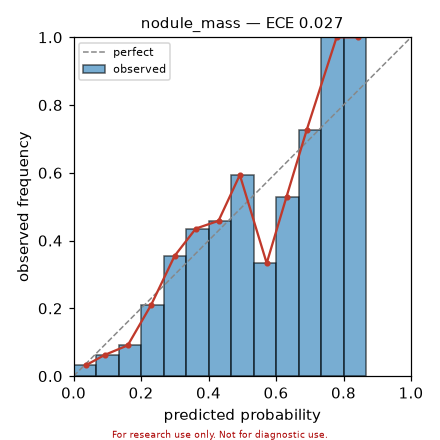
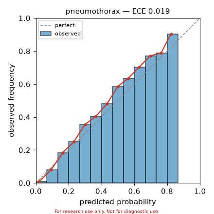
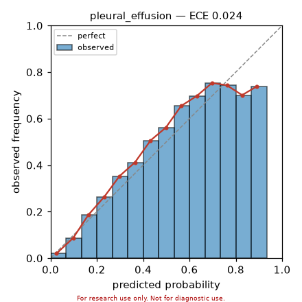
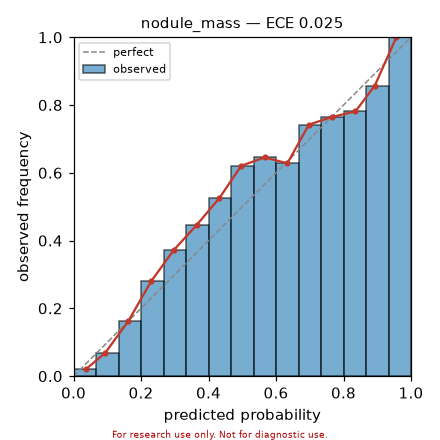

# NIH official split (`official_test`) — model `cc2f56aa3325788c`

> **For research use only. Not for diagnostic use.**

Split `nih-official-v1` (manifest sha256 `93c5fd7080e9a5fb8d58f0812ab3ba530507e0c42620463328683047a92339b3`):
tier `official_test` = NIH `test_list.txt` (25,596 images, 2,797 patients); train/val hashed
90/10 from `train_val_list.txt` patients only. Built with
`secondreader cxr split datasets/manifests/nih_cxr14.csv --version nih-official-v1 --official-nih data/raw/nih_cxr14/test_list.txt`
(D-029, R1). Evaluated on M1 Pro MPS from the `official_test` cache (320 px, ~5 min).

## Read this first: two numbers, one honest

`cc2f56aa3325788c` was trained and calibrated on `nih-v1`, a random patient split. NIH's
official test list is **not** disjoint from that: of its 25,596 images, **20,258 come from
patients in `nih-v1/train`** and 2,545 from `nih-v1/val`; only **2,793 images (301 patients)
come from `nih-v1/test`**, i.e. were never trained or tuned on. So:

| | images | what it is | pneumothorax AUROC | pleural effusion AUROC | nodule/mass AUROC |
|---|---:|---|---|---|---|
| `nih-v1` test (random split, docs/reports/nih_baseline_v1_platt/report.md) | 11,299 | held-out patients | 0.883 [0.869–0.899] | 0.886 [0.878–0.894] | 0.796 [0.784–0.812] |
| `official_test` ∩ `nih-v1` test — **the comparable number** | 2,759 | held-out patients, official list | **0.885** [0.862–0.901] | **0.829** [0.813–0.847] | **0.793** [0.758–0.821] |
| `official_test` full tier — contaminated for this model | 25,145 | 89 % seen in training | 0.935 | 0.861 | 0.848 |

(n after gating; 451 and 34 images gated out respectively, almost all by the OOD gate.)

Reading: on the honest subset, pneumothorax and nodule/mass are unchanged and pleural
effusion drops by 0.057 — the same direction and size as the literature reports for the
official split (Guendel 2018: ≈ −0.06 on effusion, ≈ −0.03 mean; see
docs/research/RECOMMENDATIONS_engineering.md §1). The subset is small (n_pos 269 / 533 / 276)
so its CIs are ~3× wider than the random-split ones. The full-tier row is kept only to show
how much a train/test overlap inflates NIH numbers (+0.05 on pneumothorax, +0.05 on
nodule/mass); it must not be quoted as this model's official-split performance.

Per view on the honest subset (AP / PA): pneumothorax 0.862 / 0.900, effusion 0.814 / 0.847,
nodule/mass 0.714 / 0.850 — the AP-vs-PA gap seen on `nih-v1` (D-026, D-028) is reproduced
on the official list (nodule/mass −0.14 here vs −0.09 on the random test).

**To get a clean full-tier official number, train on `nih-official-v1` (train 77,553 / val
8,971) and evaluate on all 25,596.** That run is deliberately not done on this machine
(D-014: no full training on the M1 Pro).

Calibration (Platt, fitted on `nih-v1` val): ECE eq-width / eq-mass ≤ 0.027 and Brier
0.065 / 0.120 / 0.073 on the honest subset — the calibration transfers to the official list
without refitting.

---

# A. Honest subset: `official_test` restricted to `nih-v1` test patients

# Evaluation — cxr-nih-baseline-v1 on nih_cxr14 (official_test_clean)

> **For research use only. Not for diagnostic use.**

- Model version: `cc2f56aa3325788c`
- Dataset: `nih_cxr14` · tier: `official_test_clean`
- Split manifest sha256: `93c5fd7080e9a5fb8d58f0812ab3ba530507e0c42620463328683047a92339b3`
- Gated out (unable to assess): 34 — {'learned: out-of-distribution': 32, 'pixels: 35% of pixels saturated': 1, 'pixels: 66% of pixels saturated': 1}

## Overall

| group | finding | n | n_pos | AUROC [95% CI] | sens [95% CI] | spec [95% CI] | ECE eq-width | ECE eq-mass | Brier | flag |
|---|---|---:|---:|---|---|---|---|---|---|---|
| all | pneumothorax | 2759 | 269 | 0.885 [0.862–0.901] | 0.881 [0.836–0.913] | 0.708 [0.689–0.726] | 0.015 | 0.012 | 0.065 |  |
| all | pleural_effusion | 2759 | 533 | 0.829 [0.813–0.847] | 0.908 [0.887–0.928] | 0.560 [0.540–0.578] | 0.021 | 0.020 | 0.120 |  |
| all | nodule_mass | 2759 | 276 | 0.793 [0.758–0.821] | 0.717 [0.659–0.762] | 0.682 [0.666–0.702] | 0.027 | 0.025 | 0.073 |  |

Operating thresholds: pneumothorax=0.040, pleural_effusion=0.099, nodule_mass=0.097

ECE eq-width = 15 equal-width bins (literature-comparable; biased at low prevalence). ECE eq-mass = 15 equal-mass bins (adaptive). Brier = proper scoring rule, binning-free.

## Calibration (reliability diagrams)

## Per-subgroup performance

Subgroup metrics are mandatory (D-010). `low-n` = fewer than 100 positives; treat those estimates as unreliable. `unavailable` = metadata absent in this dataset.

### by source

| group | finding | n | n_pos | AUROC [95% CI] | sens [95% CI] | spec [95% CI] | ECE eq-width | ECE eq-mass | Brier | flag |
|---|---|---:|---:|---|---|---|---|---|---|---|
| nih_cxr14 | pneumothorax | 2759 | 269 | 0.885 [0.862–0.901] | 0.881 [0.836–0.913] | 0.708 [0.689–0.726] | 0.015 | 0.012 | 0.065 |  |
| nih_cxr14 | pleural_effusion | 2759 | 533 | 0.829 [0.813–0.847] | 0.908 [0.887–0.928] | 0.560 [0.540–0.578] | 0.021 | 0.020 | 0.120 |  |
| nih_cxr14 | nodule_mass | 2759 | 276 | 0.793 [0.758–0.821] | 0.717 [0.659–0.762] | 0.682 [0.666–0.702] | 0.027 | 0.025 | 0.073 |  |

### by vendor

| group | finding | n | n_pos | AUROC [95% CI] | sens [95% CI] | spec [95% CI] | ECE eq-width | ECE eq-mass | Brier | flag |
|---|---|---:|---:|---|---|---|---|---|---|---|
| unavailable | pneumothorax | 2759 | 269 | 0.885 [0.862–0.901] | 0.881 [0.836–0.913] | 0.708 [0.689–0.726] | 0.015 | 0.012 | 0.065 |  |
| unavailable | pleural_effusion | 2759 | 533 | 0.829 [0.813–0.847] | 0.908 [0.887–0.928] | 0.560 [0.540–0.578] | 0.021 | 0.020 | 0.120 |  |
| unavailable | nodule_mass | 2759 | 276 | 0.793 [0.758–0.821] | 0.717 [0.659–0.762] | 0.682 [0.666–0.702] | 0.027 | 0.025 | 0.073 |  |

### by age_band

| group | finding | n | n_pos | AUROC [95% CI] | sens [95% CI] | spec [95% CI] | ECE eq-width | ECE eq-mass | Brier | flag |
|---|---|---:|---:|---|---|---|---|---|---|---|
| 18-39 | pneumothorax | 739 | 100 | 0.879 [0.845–0.906] | 0.940 [0.901–0.978] | 0.593 [0.556–0.628] | 0.027 | 0.027 | 0.083 |  |
| 18-39 | pleural_effusion | 739 | 91 | 0.845 [0.804–0.886] | 0.846 [0.774–0.926] | 0.633 [0.605–0.668] | 0.018 | 0.025 | 0.085 | low-n |
| 18-39 | nodule_mass | 739 | 74 | 0.819 [0.761–0.863] | 0.784 [0.667–0.876] | 0.680 [0.644–0.712] | 0.041 | 0.047 | 0.075 | low-n |
| 40-59 | pneumothorax | 1275 | 124 | 0.886 [0.855–0.914] | 0.863 [0.798–0.931] | 0.732 [0.704–0.757] | 0.025 | 0.016 | 0.064 |  |
| 40-59 | pleural_effusion | 1275 | 262 | 0.826 [0.801–0.851] | 0.943 [0.914–0.966] | 0.517 [0.489–0.542] | 0.026 | 0.031 | 0.126 |  |
| 40-59 | nodule_mass | 1275 | 143 | 0.790 [0.741–0.838] | 0.678 [0.608–0.761] | 0.739 [0.710–0.763] | 0.032 | 0.038 | 0.078 |  |
| 60-79 | pneumothorax | 594 | 38 | 0.888 [0.837–0.928] | 0.868 [0.738–0.969] | 0.755 [0.722–0.789] | 0.015 | 0.013 | 0.047 | low-n |
| 60-79 | pleural_effusion | 594 | 158 | 0.799 [0.758–0.833] | 0.918 [0.872–0.962] | 0.479 [0.432–0.528] | 0.059 | 0.056 | 0.154 |  |
| 60-79 | nodule_mass | 594 | 43 | 0.778 [0.691–0.857] | 0.744 [0.614–0.868] | 0.561 [0.513–0.609] | 0.062 | 0.066 | 0.061 | low-n |
| 80+ | pneumothorax | 2 | 0 | — | — | 1.000 | 0.017 | 0.017 | 0.000 | low-n |
| 80+ | pleural_effusion | 2 | 0 | — | — | 1.000 | 0.064 | 0.064 | 0.004 | low-n |
| 80+ | nodule_mass | 2 | 1 | 1.000 | 1.000 | 0.000 | 0.434 | 0.434 | 0.275 | low-n |
| <18 | pneumothorax | 149 | 7 | 0.836 [0.756–0.912] | 0.429 [0.000–0.800] | 0.838 [0.775–0.902] | 0.046 | 0.044 | 0.046 | low-n |
| <18 | pleural_effusion | 149 | 22 | 0.820 [0.746–0.903] | 0.682 [0.500–0.880] | 0.795 [0.727–0.860] | 0.069 | 0.096 | 0.107 | low-n |
| <18 | nodule_mass | 149 | 15 | 0.814 [0.689–0.904] | 0.667 [0.400–0.858] | 0.716 [0.635–0.793] | 0.040 | 0.070 | 0.070 | low-n |

### by sex

| group | finding | n | n_pos | AUROC [95% CI] | sens [95% CI] | spec [95% CI] | ECE eq-width | ECE eq-mass | Brier | flag |
|---|---|---:|---:|---|---|---|---|---|---|---|
| F | pneumothorax | 981 | 90 | 0.900 [0.877–0.925] | 0.922 [0.867–0.968] | 0.667 [0.638–0.697] | 0.027 | 0.027 | 0.062 | low-n |
| F | pleural_effusion | 981 | 208 | 0.833 [0.805–0.861] | 0.918 [0.882–0.954] | 0.560 [0.527–0.588] | 0.036 | 0.033 | 0.124 |  |
| F | nodule_mass | 981 | 83 | 0.853 [0.803–0.892] | 0.747 [0.645–0.832] | 0.742 [0.714–0.768] | 0.037 | 0.048 | 0.060 | low-n |
| M | pneumothorax | 1778 | 179 | 0.880 [0.852–0.910] | 0.860 [0.807–0.909] | 0.730 [0.711–0.749] | 0.015 | 0.011 | 0.066 |  |
| M | pleural_effusion | 1778 | 325 | 0.828 [0.804–0.851] | 0.902 [0.865–0.938] | 0.560 [0.534–0.587] | 0.021 | 0.020 | 0.117 |  |
| M | nodule_mass | 1778 | 193 | 0.762 [0.718–0.801] | 0.705 [0.637–0.770] | 0.649 [0.626–0.672] | 0.033 | 0.039 | 0.081 |  |

### by view

| group | finding | n | n_pos | AUROC [95% CI] | sens [95% CI] | spec [95% CI] | ECE eq-width | ECE eq-mass | Brier | flag |
|---|---|---:|---:|---|---|---|---|---|---|---|
| AP | pneumothorax | 1596 | 124 | 0.862 [0.827–0.888] | 0.798 [0.725–0.855] | 0.759 [0.734–0.780] | 0.022 | 0.015 | 0.057 |  |
| AP | pleural_effusion | 1596 | 342 | 0.814 [0.792–0.838] | 0.924 [0.898–0.950] | 0.525 [0.495–0.555] | 0.035 | 0.033 | 0.135 |  |
| AP | nodule_mass | 1596 | 121 | 0.714 [0.669–0.766] | 0.529 [0.439–0.613] | 0.742 [0.721–0.760] | 0.022 | 0.028 | 0.064 |  |
| PA | pneumothorax | 1163 | 145 | 0.900 [0.876–0.922] | 0.952 [0.916–0.984] | 0.634 [0.603–0.660] | 0.027 | 0.023 | 0.075 |  |
| PA | pleural_effusion | 1163 | 191 | 0.847 [0.822–0.878] | 0.880 [0.838–0.928] | 0.605 [0.574–0.637] | 0.020 | 0.023 | 0.099 |  |
| PA | nodule_mass | 1163 | 155 | 0.850 [0.815–0.885] | 0.865 [0.814–0.917] | 0.595 [0.570–0.625] | 0.046 | 0.042 | 0.086 |  |

## Notes

- Operating point: youden (chosen on internal validation).
- Global thresholds: {'pneumothorax': 0.0398, 'pleural_effusion': 0.0989, 'nodule_mass': 0.0974}
- Temperatures: {'pneumothorax': 1.714, 'pleural_effusion': 1.255, 'nodule_mass': 1.438}
- Bootstrap 95% CIs (n=200). Internal and external metrics are never averaged.
- Saliency method configured for this bundle: gradcam.

---
For research use only. Not for diagnostic use.

---

# B. Full `official_test` tier — CONTAMINATED for `cc2f56aa3325788c` (89 % of images from training patients)

Kept for the record and as the baseline a model trained on `nih-official-v1` will be compared
against on the same 25,596 images. Do not quote these as held-out performance.

# Evaluation — cxr-nih-baseline-v1 on nih_cxr14 (official_test)

> **For research use only. Not for diagnostic use.**

- Model version: `cc2f56aa3325788c`
- Dataset: `nih_cxr14` · tier: `official_test`
- Split manifest sha256: `93c5fd7080e9a5fb8d58f0812ab3ba530507e0c42620463328683047a92339b3`
- Gated out (unable to assess): 451 — {'learned: out-of-distribution': 359, 'pixels: 36% of pixels saturated': 6, 'pixels: 40% of pixels saturated': 8, 'pixels: 38% of pixels saturated': 7, 'pixels: 37% of pixels saturated': 10, 'pixels: 54% of pixels saturated': 1, 'pixels: 48% of pixels saturated': 4, 'pixels: 41% of pixels saturated': 5, 'pixels: 45% of pixels saturated': 3, 'pixels: 57% of pixels saturated': 3, 'pixels: 39% of pixels saturated': 6, 'pixels: 51% of pixels saturated': 2, 'pixels: 43% of pixels saturated': 6, 'pixels: 35% of pixels saturated': 2, 'pixels: 66% of pixels saturated': 2, 'pixels: 42% of pixels saturated': 3, 'pixels: 56% of pixels saturated': 4, 'pixels: 50% of pixels saturated': 4, 'pixels: 49% of pixels saturated': 3, 'pixels: 58% of pixels saturated': 2, 'pixels: 72% of pixels saturated': 1, 'pixels: 64% of pixels saturated': 1, 'pixels: 59% of pixels saturated': 3, 'pixels: 44% of pixels saturated': 3, 'pixels: 46% of pixels saturated': 1, 'pixels: 52% of pixels saturated': 1, 'pixels: 47% of pixels saturated': 1, 'pixels: 63% of pixels saturated': 1, 'pixels: 61% of pixels saturated': 1, 'pixels: 77% of pixels saturated': 1}

## Overall

| group | finding | n | n_pos | AUROC [95% CI] | sens [95% CI] | spec [95% CI] | ECE eq-width | ECE eq-mass | Brier | flag |
|---|---|---:|---:|---|---|---|---|---|---|---|
| all | pneumothorax | 25145 | 2500 | 0.935 [0.931–0.940] | 0.964 [0.958–0.971] | 0.685 [0.680–0.692] | 0.019 | 0.019 | 0.054 |  |
| all | pleural_effusion | 25145 | 4579 | 0.861 [0.856–0.866] | 0.924 [0.916–0.930] | 0.596 [0.589–0.603] | 0.024 | 0.022 | 0.107 |  |
| all | nodule_mass | 25145 | 2973 | 0.848 [0.841–0.857] | 0.834 [0.821–0.850] | 0.679 [0.672–0.686] | 0.025 | 0.025 | 0.079 |  |

Operating thresholds: pneumothorax=0.040, pleural_effusion=0.099, nodule_mass=0.097

ECE eq-width = 15 equal-width bins (literature-comparable; biased at low prevalence). ECE eq-mass = 15 equal-mass bins (adaptive). Brier = proper scoring rule, binning-free.

## Calibration (reliability diagrams)

## Per-subgroup performance

Subgroup metrics are mandatory (D-010). `low-n` = fewer than 100 positives; treat those estimates as unreliable. `unavailable` = metadata absent in this dataset.

### by source

| group | finding | n | n_pos | AUROC [95% CI] | sens [95% CI] | spec [95% CI] | ECE eq-width | ECE eq-mass | Brier | flag |
|---|---|---:|---:|---|---|---|---|---|---|---|
| nih_cxr14 | pneumothorax | 25145 | 2500 | 0.935 [0.931–0.940] | 0.964 [0.958–0.971] | 0.685 [0.680–0.692] | 0.019 | 0.019 | 0.054 |  |
| nih_cxr14 | pleural_effusion | 25145 | 4579 | 0.861 [0.856–0.866] | 0.924 [0.916–0.930] | 0.596 [0.589–0.603] | 0.024 | 0.022 | 0.107 |  |
| nih_cxr14 | nodule_mass | 25145 | 2973 | 0.848 [0.841–0.857] | 0.834 [0.821–0.850] | 0.679 [0.672–0.686] | 0.025 | 0.025 | 0.079 |  |

### by vendor

| group | finding | n | n_pos | AUROC [95% CI] | sens [95% CI] | spec [95% CI] | ECE eq-width | ECE eq-mass | Brier | flag |
|---|---|---:|---:|---|---|---|---|---|---|---|
| unavailable | pneumothorax | 25145 | 2500 | 0.935 [0.931–0.940] | 0.964 [0.958–0.971] | 0.685 [0.680–0.692] | 0.019 | 0.019 | 0.054 |  |
| unavailable | pleural_effusion | 25145 | 4579 | 0.861 [0.856–0.866] | 0.924 [0.916–0.930] | 0.596 [0.589–0.603] | 0.024 | 0.022 | 0.107 |  |
| unavailable | nodule_mass | 25145 | 2973 | 0.848 [0.841–0.857] | 0.834 [0.821–0.850] | 0.679 [0.672–0.686] | 0.025 | 0.025 | 0.079 |  |

### by age_band

| group | finding | n | n_pos | AUROC [95% CI] | sens [95% CI] | spec [95% CI] | ECE eq-width | ECE eq-mass | Brier | flag |
|---|---|---:|---:|---|---|---|---|---|---|---|
| 18-39 | pneumothorax | 7212 | 692 | 0.933 [0.923–0.941] | 0.967 [0.954–0.980] | 0.682 [0.672–0.692] | 0.016 | 0.014 | 0.054 |  |
| 18-39 | pleural_effusion | 7212 | 1131 | 0.869 [0.858–0.879] | 0.889 [0.871–0.908] | 0.654 [0.642–0.667] | 0.020 | 0.018 | 0.094 |  |
| 18-39 | nodule_mass | 7212 | 674 | 0.843 [0.828–0.857] | 0.825 [0.799–0.852] | 0.692 [0.682–0.706] | 0.024 | 0.021 | 0.068 |  |
| 40-59 | pneumothorax | 11099 | 1055 | 0.936 [0.930–0.943] | 0.962 [0.952–0.975] | 0.691 [0.682–0.700] | 0.020 | 0.020 | 0.053 |  |
| 40-59 | pleural_effusion | 11099 | 2088 | 0.856 [0.847–0.864] | 0.933 [0.923–0.944] | 0.576 [0.566–0.586] | 0.020 | 0.019 | 0.111 |  |
| 40-59 | nodule_mass | 11099 | 1474 | 0.851 [0.843–0.862] | 0.835 [0.819–0.854] | 0.676 [0.666–0.686] | 0.030 | 0.029 | 0.086 |  |
| 60-79 | pneumothorax | 5665 | 570 | 0.929 [0.919–0.939] | 0.965 [0.946–0.979] | 0.665 [0.651–0.677] | 0.020 | 0.019 | 0.057 |  |
| 60-79 | pleural_effusion | 5665 | 1162 | 0.864 [0.853–0.875] | 0.950 [0.937–0.961] | 0.551 [0.537–0.563] | 0.034 | 0.032 | 0.115 |  |
| 60-79 | nodule_mass | 5665 | 703 | 0.842 [0.827–0.856] | 0.841 [0.812–0.862] | 0.659 [0.648–0.674] | 0.024 | 0.025 | 0.081 |  |
| 80+ | pneumothorax | 219 | 39 | 0.903 [0.850–0.953] | 0.949 [0.884–1.000] | 0.650 [0.585–0.730] | 0.058 | 0.062 | 0.092 | low-n |
| 80+ | pleural_effusion | 219 | 39 | 0.839 [0.769–0.896] | 0.974 [0.914–1.000] | 0.406 [0.335–0.471] | 0.065 | 0.083 | 0.113 | low-n |
| 80+ | nodule_mass | 219 | 26 | 0.861 [0.782–0.923] | 0.962 [0.867–1.000] | 0.435 [0.362–0.497] | 0.075 | 0.080 | 0.087 | low-n |
| <18 | pneumothorax | 950 | 144 | 0.966 [0.951–0.977] | 0.972 [0.942–0.993] | 0.778 [0.754–0.803] | 0.034 | 0.039 | 0.053 |  |
| <18 | pleural_effusion | 950 | 159 | 0.836 [0.809–0.870] | 0.836 [0.781–0.894] | 0.674 [0.644–0.707] | 0.055 | 0.061 | 0.113 |  |
| <18 | nodule_mass | 950 | 96 | 0.865 [0.822–0.905] | 0.792 [0.699–0.875] | 0.780 [0.747–0.804] | 0.034 | 0.041 | 0.067 | low-n |

### by sex

| group | finding | n | n_pos | AUROC [95% CI] | sens [95% CI] | spec [95% CI] | ECE eq-width | ECE eq-mass | Brier | flag |
|---|---|---:|---:|---|---|---|---|---|---|---|
| F | pneumothorax | 10553 | 1193 | 0.929 [0.923–0.935] | 0.975 [0.967–0.983] | 0.635 [0.626–0.643] | 0.020 | 0.018 | 0.062 |  |
| F | pleural_effusion | 10553 | 1900 | 0.850 [0.843–0.859] | 0.925 [0.914–0.935] | 0.576 [0.567–0.588] | 0.024 | 0.025 | 0.109 |  |
| F | nodule_mass | 10553 | 1212 | 0.859 [0.849–0.871] | 0.837 [0.817–0.858] | 0.703 [0.694–0.710] | 0.029 | 0.028 | 0.076 |  |
| M | pneumothorax | 14592 | 1307 | 0.939 [0.933–0.945] | 0.955 [0.943–0.965] | 0.721 [0.714–0.727] | 0.020 | 0.020 | 0.049 |  |
| M | pleural_effusion | 14592 | 2679 | 0.868 [0.862–0.875] | 0.923 [0.914–0.933] | 0.610 [0.602–0.619] | 0.023 | 0.021 | 0.106 |  |
| M | nodule_mass | 14592 | 1761 | 0.841 [0.831–0.851] | 0.831 [0.818–0.846] | 0.661 [0.654–0.668] | 0.025 | 0.023 | 0.081 |  |

### by view

| group | finding | n | n_pos | AUROC [95% CI] | sens [95% CI] | spec [95% CI] | ECE eq-width | ECE eq-mass | Brier | flag |
|---|---|---:|---:|---|---|---|---|---|---|---|
| AP | pneumothorax | 14181 | 1010 | 0.937 [0.930–0.943] | 0.942 [0.926–0.956] | 0.739 [0.732–0.745] | 0.017 | 0.017 | 0.041 |  |
| AP | pleural_effusion | 14181 | 2846 | 0.843 [0.837–0.850] | 0.921 [0.912–0.931] | 0.566 [0.559–0.575] | 0.035 | 0.037 | 0.121 |  |
| AP | nodule_mass | 14181 | 1399 | 0.838 [0.828–0.848] | 0.795 [0.773–0.814] | 0.713 [0.704–0.721] | 0.023 | 0.023 | 0.071 |  |
| PA | pneumothorax | 10964 | 1490 | 0.925 [0.919–0.931] | 0.980 [0.972–0.987] | 0.610 [0.602–0.619] | 0.021 | 0.021 | 0.072 |  |
| PA | pleural_effusion | 10964 | 1733 | 0.886 [0.879–0.894] | 0.928 [0.918–0.942] | 0.632 [0.622–0.641] | 0.018 | 0.016 | 0.090 |  |
| PA | nodule_mass | 10964 | 1574 | 0.855 [0.846–0.866] | 0.868 [0.854–0.885] | 0.633 [0.623–0.643] | 0.030 | 0.028 | 0.089 |  |

## Notes

- Operating point: youden (chosen on internal validation).
- Global thresholds: {'pneumothorax': 0.0398, 'pleural_effusion': 0.0989, 'nodule_mass': 0.0974}
- Temperatures: {'pneumothorax': 1.714, 'pleural_effusion': 1.255, 'nodule_mass': 1.438}
- Bootstrap 95% CIs (n=200). Internal and external metrics are never averaged.
- Saliency method configured for this bundle: gradcam.

---
For research use only. Not for diagnostic use.