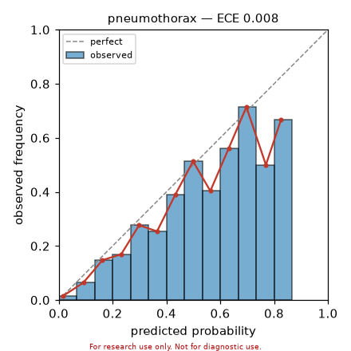
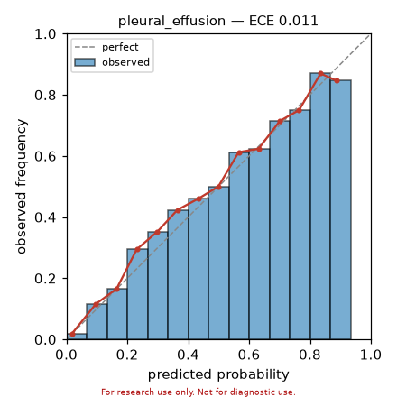
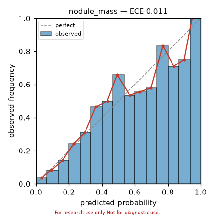

# Evaluation — cxr-nih-baseline-v1 on nih_cxr14 (test)

> **For research use only. Not for diagnostic use.**

- Model version: `e4262a38b40fbe2c`
- Dataset: `nih_cxr14` · tier: `test`
- Split manifest sha256: `96cda52f19d5b0a8a52198d5bb2045e0dabc124151ddc15be30e9607abb7ff50`
- Gated out (unable to assess): 145 — {'learned: out-of-distribution': 124, 'pixels: 36% of pixels saturated': 1, 'pixels: 56% of pixels saturated': 1, 'pixels: 41% of pixels saturated': 1, 'pixels: 35% of pixels saturated': 2, 'pixels: 47% of pixels saturated': 1, 'pixels: 48% of pixels saturated': 2, 'pixels: 43% of pixels saturated': 1, 'pixels: 37% of pixels saturated': 3, 'pixels: 40% of pixels saturated': 1, 'pixels: 39% of pixels saturated': 1, 'pixels: 42% of pixels saturated': 1, 'pixels: 61% of pixels saturated': 2, 'pixels: 46% of pixels saturated': 1, 'pixels: 49% of pixels saturated': 1, 'pixels: 71% of pixels saturated': 1, 'pixels: 59% of pixels saturated': 1, 'pixels: 66% of pixels saturated': 1}

## Overall

| group | finding | n | n_pos | AUROC [95% CI] | sens [95% CI] | spec [95% CI] | ECE eq-width | ECE eq-mass | Brier | flag |
|---|---|---:|---:|---|---|---|---|---|---|---|
| all | pneumothorax | 11302 | 535 | 0.883 [0.867–0.898] | 0.778 [0.744–0.813] | 0.818 [0.811–0.825] | 0.008 | 0.010 | 0.036 |  |
| all | pleural_effusion | 11302 | 1420 | 0.886 [0.878–0.893] | 0.848 [0.831–0.865] | 0.777 [0.769–0.785] | 0.011 | 0.012 | 0.078 |  |
| all | nodule_mass | 11302 | 1134 | 0.795 [0.777–0.813] | 0.663 [0.636–0.692] | 0.788 [0.779–0.795] | 0.011 | 0.011 | 0.073 |  |

Operating thresholds: pneumothorax=per-view (see notes), pleural_effusion=per-view (see notes), nodule_mass=per-view (see notes)

ECE eq-width = 15 equal-width bins (literature-comparable; biased at low prevalence). ECE eq-mass = 15 equal-mass bins (adaptive). Brier = proper scoring rule, binning-free.

## Calibration (reliability diagrams)

## Per-subgroup performance

Subgroup metrics are mandatory (D-010). `low-n` = fewer than 100 positives; treat those estimates as unreliable. `unavailable` = metadata absent in this dataset.

### by source

| group | finding | n | n_pos | AUROC [95% CI] | sens [95% CI] | spec [95% CI] | ECE eq-width | ECE eq-mass | Brier | flag |
|---|---|---:|---:|---|---|---|---|---|---|---|
| nih_cxr14 | pneumothorax | 11302 | 535 | 0.883 [0.867–0.898] | 0.778 [0.744–0.813] | 0.818 [0.811–0.825] | 0.008 | 0.010 | 0.036 |  |
| nih_cxr14 | pleural_effusion | 11302 | 1420 | 0.886 [0.878–0.893] | 0.848 [0.831–0.865] | 0.777 [0.769–0.785] | 0.011 | 0.012 | 0.078 |  |
| nih_cxr14 | nodule_mass | 11302 | 1134 | 0.795 [0.777–0.813] | 0.663 [0.636–0.692] | 0.788 [0.779–0.795] | 0.011 | 0.011 | 0.073 |  |

### by vendor

| group | finding | n | n_pos | AUROC [95% CI] | sens [95% CI] | spec [95% CI] | ECE eq-width | ECE eq-mass | Brier | flag |
|---|---|---:|---:|---|---|---|---|---|---|---|
| unavailable | pneumothorax | 11302 | 535 | 0.883 [0.867–0.898] | 0.778 [0.744–0.813] | 0.818 [0.811–0.825] | 0.008 | 0.010 | 0.036 |  |
| unavailable | pleural_effusion | 11302 | 1420 | 0.886 [0.878–0.893] | 0.848 [0.831–0.865] | 0.777 [0.769–0.785] | 0.011 | 0.012 | 0.078 |  |
| unavailable | nodule_mass | 11302 | 1134 | 0.795 [0.777–0.813] | 0.663 [0.636–0.692] | 0.788 [0.779–0.795] | 0.011 | 0.011 | 0.073 |  |

### by age_band

| group | finding | n | n_pos | AUROC [95% CI] | sens [95% CI] | spec [95% CI] | ECE eq-width | ECE eq-mass | Brier | flag |
|---|---|---:|---:|---|---|---|---|---|---|---|
| 18-39 | pneumothorax | 3185 | 177 | 0.886 [0.862–0.916] | 0.819 [0.763–0.881] | 0.794 [0.779–0.811] | 0.013 | 0.013 | 0.040 |  |
| 18-39 | pleural_effusion | 3185 | 277 | 0.889 [0.870–0.908] | 0.787 [0.739–0.831] | 0.806 [0.792–0.820] | 0.011 | 0.011 | 0.060 |  |
| 18-39 | nodule_mass | 3185 | 252 | 0.795 [0.765–0.825] | 0.643 [0.573–0.698] | 0.807 [0.793–0.819] | 0.016 | 0.014 | 0.060 |  |
| 40-59 | pneumothorax | 5121 | 223 | 0.881 [0.860–0.904] | 0.767 [0.712–0.818] | 0.829 [0.819–0.839] | 0.011 | 0.014 | 0.034 |  |
| 40-59 | pleural_effusion | 5121 | 688 | 0.886 [0.874–0.898] | 0.856 [0.832–0.882] | 0.778 [0.767–0.790] | 0.019 | 0.016 | 0.082 |  |
| 40-59 | nodule_mass | 5121 | 543 | 0.800 [0.778–0.823] | 0.680 [0.640–0.718] | 0.800 [0.787–0.811] | 0.014 | 0.012 | 0.076 |  |
| 60-79 | pneumothorax | 2454 | 121 | 0.884 [0.856–0.911] | 0.785 [0.710–0.849] | 0.807 [0.792–0.823] | 0.010 | 0.013 | 0.039 |  |
| 60-79 | pleural_effusion | 2454 | 406 | 0.870 [0.853–0.886] | 0.889 [0.860–0.917] | 0.701 [0.683–0.723] | 0.018 | 0.018 | 0.098 |  |
| 60-79 | nodule_mass | 2454 | 283 | 0.761 [0.727–0.790] | 0.647 [0.591–0.692] | 0.726 [0.710–0.745] | 0.014 | 0.023 | 0.085 |  |
| 80+ | pneumothorax | 66 | 1 | 0.246 [0.154–0.359] | 0.000 [0.000–0.000] | 0.754 [0.641–0.849] | 0.041 | 0.070 | 0.029 | low-n |
| 80+ | pleural_effusion | 66 | 6 | 0.922 [0.766–1.000] | 0.833 [0.498–1.000] | 0.817 [0.724–0.912] | 0.093 | 0.091 | 0.061 | low-n |
| 80+ | nodule_mass | 66 | 13 | 0.720 [0.590–0.851] | 0.769 [0.571–1.000] | 0.604 [0.449–0.726] | 0.104 | 0.167 | 0.145 | low-n |
| <18 | pneumothorax | 476 | 13 | 0.912 [0.868–0.955] | 0.385 [0.143–0.650] | 0.929 [0.903–0.951] | 0.014 | 0.016 | 0.024 | low-n |
| <18 | pleural_effusion | 476 | 43 | 0.903 [0.849–0.943] | 0.721 [0.580–0.854] | 0.915 [0.885–0.937] | 0.037 | 0.049 | 0.063 | low-n |
| <18 | nodule_mass | 476 | 43 | 0.851 [0.781–0.920] | 0.651 [0.500–0.796] | 0.861 [0.825–0.890] | 0.019 | 0.032 | 0.058 | low-n |

### by sex

| group | finding | n | n_pos | AUROC [95% CI] | sens [95% CI] | spec [95% CI] | ECE eq-width | ECE eq-mass | Brier | flag |
|---|---|---:|---:|---|---|---|---|---|---|---|
| F | pneumothorax | 4802 | 234 | 0.856 [0.830–0.880] | 0.752 [0.701–0.804] | 0.778 [0.765–0.788] | 0.013 | 0.015 | 0.039 |  |
| F | pleural_effusion | 4802 | 670 | 0.891 [0.880–0.905] | 0.860 [0.836–0.891] | 0.782 [0.771–0.795] | 0.021 | 0.021 | 0.082 |  |
| F | nodule_mass | 4802 | 467 | 0.802 [0.780–0.824] | 0.655 [0.617–0.697] | 0.802 [0.791–0.815] | 0.011 | 0.016 | 0.072 |  |
| M | pneumothorax | 6500 | 301 | 0.903 [0.886–0.917] | 0.797 [0.758–0.836] | 0.848 [0.841–0.858] | 0.005 | 0.006 | 0.034 |  |
| M | pleural_effusion | 6500 | 750 | 0.882 [0.870–0.892] | 0.837 [0.811–0.864] | 0.773 [0.760–0.783] | 0.010 | 0.013 | 0.075 |  |
| M | nodule_mass | 6500 | 667 | 0.790 [0.769–0.809] | 0.669 [0.635–0.701] | 0.777 [0.766–0.787] | 0.012 | 0.013 | 0.075 |  |

### by view

| group | finding | n | n_pos | AUROC [95% CI] | sens [95% CI] | spec [95% CI] | ECE eq-width | ECE eq-mass | Brier | flag |
|---|---|---:|---:|---|---|---|---|---|---|---|
| AP | pneumothorax | 4451 | 208 | 0.862 [0.838–0.884] | 0.788 [0.740–0.841] | 0.751 [0.737–0.764] | 0.009 | 0.010 | 0.038 |  |
| AP | pleural_effusion | 4451 | 732 | 0.848 [0.835–0.860] | 0.872 [0.850–0.896] | 0.666 [0.655–0.679] | 0.027 | 0.027 | 0.106 |  |
| AP | nodule_mass | 4451 | 384 | 0.738 [0.714–0.765] | 0.547 [0.496–0.597] | 0.773 [0.760–0.785] | 0.014 | 0.018 | 0.070 |  |
| PA | pneumothorax | 6851 | 327 | 0.895 [0.878–0.912] | 0.771 [0.723–0.813] | 0.862 [0.855–0.869] | 0.011 | 0.011 | 0.035 |  |
| PA | pleural_effusion | 6851 | 688 | 0.905 [0.894–0.917] | 0.823 [0.792–0.854] | 0.843 [0.833–0.853] | 0.007 | 0.006 | 0.060 |  |
| PA | nodule_mass | 6851 | 750 | 0.825 [0.809–0.842] | 0.723 [0.690–0.752] | 0.798 [0.787–0.809] | 0.018 | 0.017 | 0.076 |  |

## Notes

- Operating point: youden (chosen on internal validation).
- Global thresholds: {'pneumothorax': 0.0398, 'pleural_effusion': 0.0989, 'nodule_mass': 0.0974}
- Per-view thresholds (D-029), used for rows whose `view` matches; other views use the global threshold: {'AP': {'pneumothorax': 0.0359, 'pleural_effusion': 0.0976, 'nodule_mass': 0.1013}, 'PA': {'pneumothorax': 0.071, 'pleural_effusion': 0.1223, 'nodule_mass': 0.1142}}
- Temperatures: {'pneumothorax': 1.714, 'pleural_effusion': 1.255, 'nodule_mass': 1.438}
- Bootstrap 95% CIs (n=200). Internal and external metrics are never averaged.
- Saliency method configured for this bundle: gradcam.

---
For research use only. Not for diagnostic use.