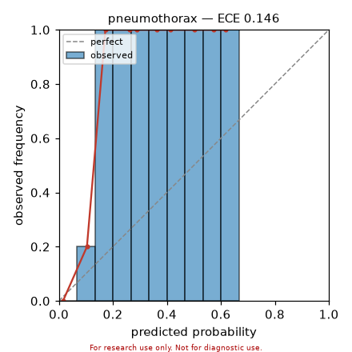
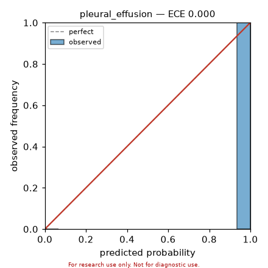
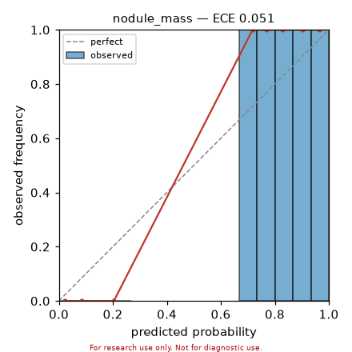

# Evaluation — cxr-smoke on synth-b (external)

> **Synthetic smoke run.** This report was produced on the generated synthetic dataset to prove the pipeline end-to-end. The numbers say nothing about real chest radiographs.

> **For research use only. Not for diagnostic use.**

- Model version: `8b05f574b2787dbf`
- Dataset: `synth-b` · tier: `external`
- Split manifest sha256: `d57f0524df21d4fe23b54012cc350410cb203521e1f9bb4607beec53629e2fad`
- Gated out (unable to assess): 25 — {'learned: out-of-distribution input (feature distance 76.1 > 75.0)': 1, 'learned: out-of-distribution input (feature distance 95.3 > 75.0)': 1, 'header: non-frontal view': 18, 'learned: view classifier': 18, 'learned: out-of-distribution input (feature distance 178.0 > 75.0)': 1, 'learned: out-of-distribution input (feature distance 163.4 > 75.0)': 1, 'learned: out-of-distribution input (feature distance 124.6 > 75.0)': 1, 'learned: out-of-distribution input (feature distance 106.7 > 75.0)': 1, 'learned: out-of-distribution input (feature distance 127.9 > 75.0)': 1, 'learned: out-of-distribution input (feature distance 88.3 > 75.0)': 1, 'learned: out-of-distribution input (feature distance 128.0 > 75.0)': 1, 'learned: out-of-distribution input (feature distance 122.5 > 75.0)': 1, 'learned: out-of-distribution input (feature distance 121.8 > 75.0)': 1, 'learned: out-of-distribution input (feature distance 177.7 > 75.0)': 1, 'learned: out-of-distribution input (feature distance 119.5 > 75.0)': 1, 'learned: out-of-distribution input (feature distance 82.8 > 75.0)': 1, 'learned: out-of-distribution input (feature distance 191.0 > 75.0)': 1, 'learned: out-of-distribution input (feature distance 132.5 > 75.0)': 1, 'learned: out-of-distribution input (feature distance 196.7 > 75.0)': 1, 'learned: out-of-distribution input (feature distance 132.2 > 75.0)': 1, 'learned: out-of-distribution input (feature distance 128.5 > 75.0)': 1, 'learned: out-of-distribution input (feature distance 115.7 > 75.0)': 1, 'learned: out-of-distribution input (feature distance 116.8 > 75.0)': 1, 'learned: out-of-distribution input (feature distance 80.8 > 75.0)': 1, 'learned: out-of-distribution input (feature distance 131.9 > 75.0)': 1, 'learned: out-of-distribution input (feature distance 168.8 > 75.0)': 1, 'learned: out-of-distribution input (feature distance 75.6 > 75.0)': 1}

## Overall

| group | finding | n | n_pos | AUROC [95% CI] | sens [95% CI] | spec [95% CI] | ECE | flag |
|---|---|---:|---:|---|---|---|---|---|
| all | pneumothorax | 75 | 17 | 1.000 [1.000–1.000] | 0.882 [0.706–1.000] | 1.000 [1.000–1.000] | 0.146 | low-n |
| all | pleural_effusion | 75 | 21 | 1.000 [1.000–1.000] | 1.000 [1.000–1.000] | 1.000 [1.000–1.000] | 0.000 | low-n |
| all | nodule_mass | 75 | 21 | 1.000 [1.000–1.000] | 1.000 [1.000–1.000] | 1.000 [1.000–1.000] | 0.051 | low-n |

Operating thresholds: pneumothorax=0.161, pleural_effusion=0.500, nodule_mass=0.259

## Calibration (reliability diagrams)

## Per-subgroup performance

Subgroup metrics are mandatory (D-010). `low-n` = fewer than 100 positives; treat those estimates as unreliable. `unavailable` = metadata absent in this dataset.

### by source

| group | finding | n | n_pos | AUROC [95% CI] | sens [95% CI] | spec [95% CI] | ECE | flag |
|---|---|---:|---:|---|---|---|---|---|
| synth-b | pneumothorax | 75 | 17 | 1.000 [1.000–1.000] | 0.882 [0.706–1.000] | 1.000 [1.000–1.000] | 0.146 | low-n |
| synth-b | pleural_effusion | 75 | 21 | 1.000 [1.000–1.000] | 1.000 [1.000–1.000] | 1.000 [1.000–1.000] | 0.000 | low-n |
| synth-b | nodule_mass | 75 | 21 | 1.000 [1.000–1.000] | 1.000 [1.000–1.000] | 1.000 [1.000–1.000] | 0.051 | low-n |

### by vendor

| group | finding | n | n_pos | AUROC [95% CI] | sens [95% CI] | spec [95% CI] | ECE | flag |
|---|---|---:|---:|---|---|---|---|---|
| FauxVendor-1 | pneumothorax | 49 | 9 | 1.000 [1.000–1.000] | 0.889 [0.600–1.000] | 1.000 [1.000–1.000] | 0.129 | low-n |
| FauxVendor-1 | pleural_effusion | 49 | 11 | 1.000 [1.000–1.000] | 1.000 [1.000–1.000] | 1.000 [1.000–1.000] | 0.000 | low-n |
| FauxVendor-1 | nodule_mass | 49 | 15 | 1.000 [1.000–1.000] | 1.000 [1.000–1.000] | 1.000 [1.000–1.000] | 0.045 | low-n |
| FauxVendor-2 | pneumothorax | 26 | 8 | 1.000 [1.000–1.000] | 0.875 [0.667–1.000] | 1.000 [1.000–1.000] | 0.200 | low-n |
| FauxVendor-2 | pleural_effusion | 26 | 10 | 1.000 [1.000–1.000] | 1.000 [1.000–1.000] | 1.000 [1.000–1.000] | 0.000 | low-n |
| FauxVendor-2 | nodule_mass | 26 | 6 | 1.000 [1.000–1.000] | 1.000 [1.000–1.000] | 1.000 [1.000–1.000] | 0.063 | low-n |

### by age_band

| group | finding | n | n_pos | AUROC [95% CI] | sens [95% CI] | spec [95% CI] | ECE | flag |
|---|---|---:|---:|---|---|---|---|---|
| 18-39 | pneumothorax | 20 | 3 | 1.000 [1.000–1.000] | 1.000 [1.000–1.000] | 1.000 [1.000–1.000] | 0.104 | low-n |
| 18-39 | pleural_effusion | 20 | 1 | 1.000 [1.000–1.000] | 1.000 [1.000–1.000] | 1.000 [1.000–1.000] | 0.000 | low-n |
| 18-39 | nodule_mass | 20 | 6 | 1.000 [1.000–1.000] | 1.000 [1.000–1.000] | 1.000 [1.000–1.000] | 0.028 | low-n |
| 40-59 | pneumothorax | 20 | 5 | 1.000 [1.000–1.000] | 0.600 [0.000–1.000] | 1.000 [1.000–1.000] | 0.170 | low-n |
| 40-59 | pleural_effusion | 20 | 8 | 1.000 [1.000–1.000] | 1.000 [1.000–1.000] | 1.000 [1.000–1.000] | 0.000 | low-n |
| 40-59 | nodule_mass | 20 | 6 | 1.000 [1.000–1.000] | 1.000 [1.000–1.000] | 1.000 [1.000–1.000] | 0.071 | low-n |
| 60-79 | pneumothorax | 14 | 2 | 1.000 | 1.000 | 1.000 | 0.096 | low-n |
| 60-79 | pleural_effusion | 14 | 6 | 1.000 | 1.000 | 1.000 | 0.000 | low-n |
| 60-79 | nodule_mass | 14 | 3 | 1.000 | 1.000 | 1.000 | 0.041 | low-n |
| 80+ | pneumothorax | 21 | 7 | 1.000 [1.000–1.000] | 1.000 [1.000–1.000] | 1.000 [1.000–1.000] | 0.222 | low-n |
| 80+ | pleural_effusion | 21 | 6 | 1.000 [1.000–1.000] | 1.000 [1.000–1.000] | 1.000 [1.000–1.000] | 0.000 | low-n |
| 80+ | nodule_mass | 21 | 6 | 1.000 [1.000–1.000] | 1.000 [1.000–1.000] | 1.000 [1.000–1.000] | 0.061 | low-n |

### by sex

| group | finding | n | n_pos | AUROC [95% CI] | sens [95% CI] | spec [95% CI] | ECE | flag |
|---|---|---:|---:|---|---|---|---|---|
| F | pneumothorax | 40 | 10 | 1.000 [1.000–1.000] | 0.900 [0.667–1.000] | 1.000 [1.000–1.000] | 0.156 | low-n |
| F | pleural_effusion | 40 | 11 | 1.000 [1.000–1.000] | 1.000 [1.000–1.000] | 1.000 [1.000–1.000] | 0.000 | low-n |
| F | nodule_mass | 40 | 12 | 1.000 [1.000–1.000] | 1.000 [1.000–1.000] | 1.000 [1.000–1.000] | 0.045 | low-n |
| M | pneumothorax | 35 | 7 | 1.000 [1.000–1.000] | 0.857 [0.599–1.000] | 1.000 [1.000–1.000] | 0.145 | low-n |
| M | pleural_effusion | 35 | 10 | 1.000 [1.000–1.000] | 1.000 [1.000–1.000] | 1.000 [1.000–1.000] | 0.000 | low-n |
| M | nodule_mass | 35 | 9 | 1.000 [1.000–1.000] | 1.000 [1.000–1.000] | 1.000 [1.000–1.000] | 0.058 | low-n |

### by view

| group | finding | n | n_pos | AUROC [95% CI] | sens [95% CI] | spec [95% CI] | ECE | flag |
|---|---|---:|---:|---|---|---|---|---|
| AP | pneumothorax | 18 | 5 | 1.000 | 0.800 | 1.000 | 0.176 | low-n |
| AP | pleural_effusion | 18 | 6 | 1.000 | 1.000 | 1.000 | 0.000 | low-n |
| AP | nodule_mass | 18 | 6 | 1.000 | 1.000 | 1.000 | 0.060 | low-n |
| PA | pneumothorax | 57 | 12 | 1.000 [1.000–1.000] | 0.917 [0.714–1.000] | 1.000 [1.000–1.000] | 0.150 | low-n |
| PA | pleural_effusion | 57 | 15 | 1.000 [1.000–1.000] | 1.000 [1.000–1.000] | 1.000 [1.000–1.000] | 0.000 | low-n |
| PA | nodule_mass | 57 | 15 | 1.000 [1.000–1.000] | 1.000 [1.000–1.000] | 1.000 [1.000–1.000] | 0.048 | low-n |

## Notes

- Operating point: youden (chosen on internal validation).
- Temperatures: {'pneumothorax': 0.821, 'pleural_effusion': 0.25, 'nodule_mass': 0.657}
- Bootstrap 95% CIs (n=200). Internal and external metrics are never averaged.

---
For research use only. Not for diagnostic use.